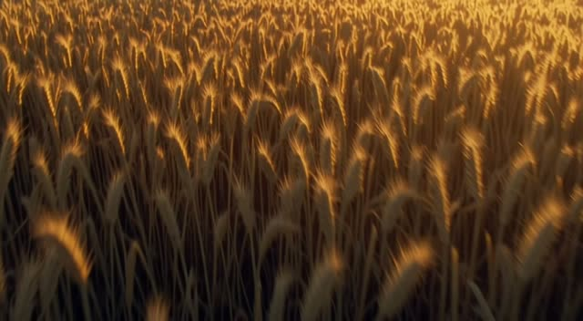
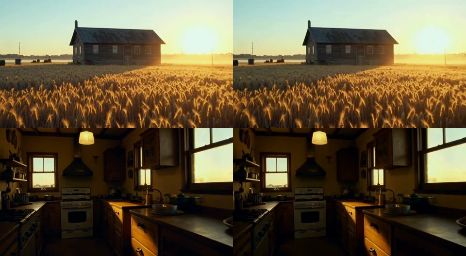

# Wheat field, through the farmhouse door, out the kitchen window

**Every clip starts on the last frame of the one before it, so three separate generations play as one continuous shot.**

[Watch the 15 second preview](results/preview.mp4) (960 px wide, no audio, joins trimmed of duplicate frames).

| | |
|---|---|
| Model | P-Video |
| Clips | 3, each 5 s, 720p, 24 fps (output 1280x704) |
| Chain | first frame of clip 2 and clip 3 only; no last-frame target was used |
| Move | push-in across a field, through a door, out a window, up to an aerial |
| Author | FXI Studio |

## What you need

- An image-to-video model that accepts a first frame. The shots here used P-Video.
- `ffmpeg` to pull the exact chain frame out of each clip.
- Either the [fxi-frame-chain CLI](../../README.md) with a backend, or an FXI Studio account (see [reproduce.md](reproduce.md)).

## The shots

| # | Move | Prompt | First frame |
|---|---|---|---|
| 1 | Push-in across wheat toward a farmhouse, end on the door | [prompts/01.txt](prompts/01.txt) | none (text only) |
| 2 | Dolly to the house, through the door, into a kitchen | [prompts/02.txt](prompts/02.txt) | [inputs/clip-2-first-frame.jpg](inputs/clip-2-first-frame.jpg) |
| 3 | Push past the lamp, out the window, rise to an aerial | [prompts/03.txt](prompts/03.txt) | [inputs/clip-3-first-frame.jpg](inputs/clip-3-first-frame.jpg) |

Plan as data: [shots.json](shots.json). Exact settings sent: [sent.json](sent.json). CLI request: [scenes.json](scenes.json).

## Results

The seams. Top row: last chain frame of clip 1 (left) next to the first frame of clip 2 (right). Bottom row: the same for clip 2 into clip 3.

Measured match (SSIM, 1.0 is identical): clip 2 frame 0 against its input frame 0.96; clip 3 frame 0 against its input frame 0.90. The input frame itself matches frame 119 of the previous clip at 0.99, and frames 118 and 120 at about 0.83.

Poster frames: [clip 1 start](results/clip-1-first.jpg), [clip 2 middle](results/clip-2-mid.jpg), [clip 3 middle](results/clip-3-mid.jpg), [clip 3 end](results/clip-3-last.jpg).

## Limits, stated plainly

- The join is close, not perfect. Clip 3 starts visibly less like its input frame (0.90) than clip 2 does (0.96).
- The look drifts. The middle of clip 2 is a cool dusk blue, while the shots on either side are golden sunrise.
- The prompts ask for a door that swings open and a wooden table with an oil lamp. The frames show a door that stays shut in the middle of clip 2, and a kitchen with a pendant lamp and no clear table. The model followed the move, not every prop.
- Clip 1 had no input image. The CLI and the connector both need a starting image, so [reproduce.md](reproduce.md) uses a frame taken from the finished clip as a stand-in.
- No audio is included.
- One take per clip is documented. Earlier attempts, if any, were not recorded, so this page does not describe them. See [why.md](why.md).

## Files

`README.md`, `shots.json`, `sent.json`, `scenes.json`, `prompts/`, `inputs/`, `results/`, `why.md`, `reproduce.md`.

The text and settings in this folder are MIT licensed with the repository. The media in `inputs/` and `results/` was generated with FXI Studio and is (c) FUELED BY IMAGINATION, LLC, all rights reserved, like the demo media in `docs/`.
